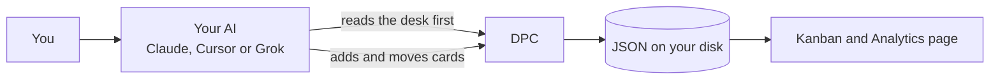
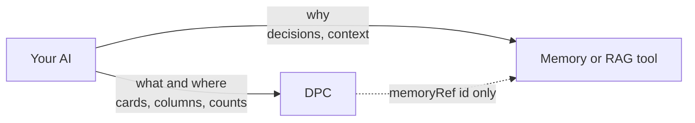
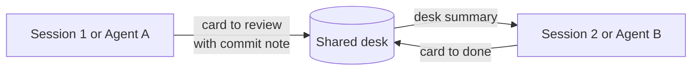

<div align="center">

<picture>
  <source media="(prefers-color-scheme: dark)" srcset="docs/images/logo-dark.svg">
  
</picture>

# Dev Project Coordinator

**Local desk for agents.** Track coding and non coding work as JSON on your machine. Agents keep the board. You open a local Analytics tab and Kanban tab.

Formerly Claude Project Coordinator.

[](LICENSE)
[](https://www.swift.org)
[](https://github.com/M-Pineapple/Dev-Project-Coordinator/stargazers)
[](https://glama.ai/mcp/servers/M-Pineapple/Dev-Project-Coordinator)
[](https://www.buymeacoffee.com/mpineapple)

<picture><source media="(prefers-color-scheme: dark)" srcset="docs/images/analytics-dark.png"></picture>
<picture><source media="(prefers-color-scheme: dark)" srcset="docs/images/kanban-dark.png"></picture>


</div>

**Give your AI a project board it reads at the start of every chat, so work survives between sessions and between agents.**

## What this does

Your AI agents keep a small Kanban of every project you run, coding or not: what is in progress, what is blocked, what is waiting for review, and the commit or link that proves something shipped. When a new chat starts, the agent asks the desk for a summary of under 800 tokens and gets back on track, instead of guessing or rereading your repo. You do not need a memory or RAG tool for this. It works on its own, provided the agent's rules tell it to read the desk at the start of each session. If you do use a memory tool, the two sit side by side: memory keeps the why, DPC keeps the what and where. Everything stays as JSON on your own disk, and you get a local Analytics and Kanban page where you can drag cards yourself.

## What you can ask

Type these as you would to any assistant. Each one maps to a real DPC tool.

| You type | Tool | What happens |
|---|---|---|
| "What is on my desk?" | `get_desk_summary` | The compact state of every project. Ask this first in each session so the agent starts from the truth, not from memory |
| "I am in this repo. Register it." | `register_from_workspace` | Reads the folder and git remote, detects the language, and adds a starter card. It never creates folders |
| "Add a card for the failing tests and put it in doing." | `add_card`, `move_card` | A new card in the doing column of the current project |
| "Move the login fix to review, note commit 299b827." | `move_card` with `note` | The card moves and carries a short evidence line, so the next session or agent sees what was done |
| "File this under a legal project called Q4 review." | `file_under_project` | Finds or creates a project with no folder, for writing, legal, accounting or other non coding work |
| "Which projects need attention?" | `get_project_health`, `get_activity_heatmap` | Health scores with reasons, and where activity has gone quiet |

## How it works

Everyday flow. You talk to your AI, the AI reads and updates the desk, and the desk is plain JSON you can also open as a page.



Beside a memory or RAG tool. DPC holds the live board, memory holds the reasons. The only link is a `memoryRef` id on a card. DPC never calls the memory tool. With no memory tool, leave `memoryRef` empty and DPC works alone.



Handoff between sessions or agents. One session or agent leaves a card in review with a note, the next one reads the desk summary and carries on. To share one desk across machines, sync its folder with git (see the [shared board guide](docs/shared-board/README.md)).



## Who this is for

People who run AI agents across several projects and are tired of each new chat starting cold. People who mix code with writing, legal, accounting or campaign work in the same chat. Anyone running several agents who needs one truthful board they all read and update. And anyone who wants this kept local, with no account and no telemetry.

## How it fits with memory and RAG

| | DPC | Memory / RAG |
|---|---|---|
| Job | Live structured state: column, counts, board | Durable why, decisions, people |
| Shape | Exact rows and a Kanban | Similar chunks |
| Ask | "What is blocked right now?" | "Why did we choose X last month?" |

Put only a `memoryRef` (opaque id or tag) on a card. DPC never calls a memory service and never copies the prose. If you use RAG only, exact counts and a current board are not available. If you use neither, DPC still keeps your agents on track between sessions.

### What it is not

- Not a memory or RAG product. There are no embeddings and no semantic search.
- `search_desk` is a plain text match over notes, cards, kinds and markdown.
- No live sync. Sharing a board uses git push and pull. Merges are a union by card id.
- No Trello, Asana or Jira sync. Use those vendors' own MCPs beside DPC.
- `memoryRef` is only an id. DPC cannot fetch the decision it points to.
- Nothing reads the desk automatically. Your host's rules or prompt (for example `CLAUDE.md`, `AGENTS.md` or [docs/grok-bot/PROMPT.md](docs/grok-bot/PROMPT.md)) must tell the agent to call `get_desk_summary` at the start.
- The desk server is local only, bound to `127.0.0.1`. Cloud agents reach a desk through the shared board route, not the Dock app.

---

DPC is a local stdio MCP server. It stores live project state (column, kind, counts, cards) as JSON. It does not host your data. It does not replace a memory or RAG product.

**v2.0.1** · [official Swift MCP SDK](https://github.com/modelcontextprotocol/swift-sdk) · Apache 2.0 · local JSON knowledge base

---

## Quick start

Needs macOS 13+, Swift 6.0+ (Xcode 16+) and an MCP host (Claude Desktop, Cursor, Claude Code, or Grok Build). Linux runs through the Dockerfile.

1. Build:

   ```bash
   git clone https://github.com/M-Pineapple/Dev-Project-Coordinator.git
   cd Dev-Project-Coordinator
   swift build -c release
   ```

2. Add the server. The binary name stays `project-coordinator`. `dpc` is an alias.

   ```json
   {
     "mcpServers": {
       "project-coordinator": {
         "command": "/absolute/path/to/Dev-Project-Coordinator/.build/release/project-coordinator",
         "args": []
       }
     }
   }
   ```

3. Restart the host. Ask: "What is on my desk?" The agent should call `get_desk_summary` first.

Coding folders must sit under an [allowed root](#security-configuration). Non coding work can have no path.

---

## Open it as a Mac app

The desk page is a local file by default. For drag-and-drop, and to pin it in the Dock like an app:

1. Ask the agent to start the desk server, or run `dpc start_desk_server`.
2. Open the **sign-in URL** once in Safari. It carries a one-time code, valid once, for 10 minutes. That sets a session cookie (the write token) and redirects to `http://127.0.0.1:47821/` with no code in the address bar.
3. Safari: **File > Add to Dock**. The Dock shortcut is the plain URL. It does not store the code or the write token.

The port is fixed at **47821**. Change it with `DPC_DESK_PORT` or `deskPort` in `security-config.json`. If that port is busy, start fails with a clear error. It does not pick a random port.

Call `start_desk_server` again while it is running to mint a fresh sign-in code without rotating the write token. Rotate the write token with `start_desk_server` `rotate=true`, or `dpc start_desk_server --rotate`. Open the new sign-in URL once so the Dock app cookie updates.

---

## Starting points by setup

### 1. Agent user with several repos

You already have coding agents. You do not want a second project-management SaaS.

**Start with:**
- "I am in this repo. Register it."
- "What is blocked right now?"
- "Add a card for the failing tests and put it in doing."

**What you get:** silent register from cwd and git remote, a compact desk under 800 tokens, cards linked to a PR when you pass one.

### 2. Mixed coding and non coding desk

You also run accounting, legal, writing, or campaign work in the same chat.

**Start with:**
- "File this under a legal project called Q4 review."
- "Rename that to Autumn review."
- "Merge Duplicate Campaign into Autumn review."

**What you get:** find-or-create with no folder, a one-line notice `Filed under new project: …`, and rename/merge when the guess is wrong.

### 3. Privacy first local setup

You will not send a board to a hosted PM tool.

**Start with:**
- Build from source. Point the host at `.build/release/project-coordinator`.
- Optional: `DPC_KNOWLEDGE_BASE` for data outside the git tree. `CPC_KNOWLEDGE_BASE` still works through v2.x.
- Open `KnowledgeBase/desk/index.html` from disk.

**What you get:** JSON on your disk, path allowlisting, no account, no telemetry.

### 4. Already using a memory or RAG product

You store decisions in a memory MCP. You do not want that text copied here.

**How they fit together:** see [How it fits with memory and RAG](#how-it-fits-with-memory-and-rag). Put only a `memoryRef` on a card. DPC never copies the prose.

### 5. Grok Bot user

You want a specialised desk operator.

**Start with:** paste [docs/grok-bot/PROMPT.md](docs/grok-bot/PROMPT.md), then add this MCP by hand. Templates cannot carry a custom MCP.

**What you get:** the same JSON desk. An optional private Grok Bot Page is a view, not a second store. Never auto-share.

---

## Full feature list

### Desk

| Capability | Detail |
|---|---|
| Compact summary | `get_desk_summary`, hard cap 800 tokens (~3,200 characters) |
| Any language | Shallow detector: swift, python, javascript, typescript, node, go, rust, ruby, php, java, kotlin, csharp, dotnet, cpp, docker, web, plus spm / xcode-project / xcode-workspace / swiftui from top-level files |
| Non coding kinds | writing, campaign, research, legal, accounting, business, personal, other. Path optional |
| Auto-register | From cwd + git remote + optional open PR. Never creates folders. Adds a starter card |
| Find or create | Normalised name match, near-duplicate guard, rename and merge. Adds a starter card |
| Kanban | Columns backlog, doing, review, done, parked. Users may rename |
| Cards | id, project, title, column, order, due, optional memoryRef, optional note. `note` is omitted when empty. No archive field is stored |
| Local page | Analytics tab + Kanban tab as `KnowledgeBase/desk/index.html` |
| Interactive board | Opt-in `start_desk_server` on 127.0.0.1:47821, 0600 write token, Safari Add to Dock |

Done cards whose `updated` time is older than 14 days are hidden on the Done column. **Show archived (N)** reveals them, muted. The Done in 7 days stat and the analytics tab still count every card. Nothing is deleted, and `cards.json` does not gain an archive field, so a shared-board merge stays a union by card id. Set the window with `DPC_ARCHIVE_DAYS` or `archiveDays` in `security-config.json`. `get_desk_summary` and `get_project_status` skip archived cards and still report the count. Pass `includeArchived` to list them. `search_desk` still finds them and marks them archived. Moving a card out of done, or any edit that refreshes `updated`, brings it back.

A card may also carry an optional `note`, a short evidence line such as `Tech: commit 299b827` or a URL. Set it with `add_card`, `update_card`, or `move_card`. The board shows it in small muted text, and `search_desk` matches it. Leaving `note` off a move keeps the current line. A blank note clears it.

### Analytics tab

The same JSON the MCP tools read, rendered as a local dashboard (file and live modes):

| Section | What you see |
|---|---|
| Attention | Five items that need a look, ranked |
| Board flow | Column mix, stale cards (14 days), 7-day throughput into done, parked count |
| Kind mix | Coding vs writing, legal, accounting, and the rest |
| Project health | 0 to 100 score per project, factors, recommendations, grouped critical / needs attention / healthy. Non coding projects are not scored down for missing code docs or a tech stack |
| Activity heat map | Per project, last 14 days, CSS intensity cells and a sparkline. Total events. No emoji |
| Technology trends | Share bars, emerging tags (1 or 2 coding projects), adoption timeline. Coding projects only |
| Project timeline | Created date, current status, time in each status. Collapsible per project |

No emoji as data. No remote fonts or assets. Light and dark follow the system.

### Safety and storage

| Capability | Detail |
|---|---|
| Local JSON | `KnowledgeBase/projects/` and `KnowledgeBase/desk/` |
| Path allowlist | Compiled roots plus `SecurityConfig.allowedPaths` and `DPC_ALLOWED_PATHS` |
| Input limits | Name, path, notes, and search length capped |
| HTML | User strings escaped on the desk page |
| Env | `DPC_KNOWLEDGE_BASE` preferred, `CPC_KNOWLEDGE_BASE` until v3.0 |
| Stdio-safe logs | Diagnostics go to stderr only, prefix `[DPC]` |

---

## All MCP tools

| Tool | Parameters | Purpose |
|---|---|---|
| `get_desk_summary` | optional `includeArchived` | Compact desk. Use this first. Archived done cards are omitted unless `includeArchived` is true. The archived count is always reported |
| `list_projects` | none | Full roster. Deep dive only |
| `get_project_status` | `projectName`, optional `includeArchived` | Full detail for one project. The card list skips archived done cards unless `includeArchived` is true |
| `add_project` | `name`, optional `path`, `description`, `kind` | Manual add |
| `update_project_status` | `projectName`, optional `status`, `notes` | Update the desk entry |
| `search_desk` | `pattern` | Search notes, cards, kinds, markdown. Archived cards are included and marked |
| `search_code_patterns` | `pattern` | Deprecated alias of `search_desk` |
| `get_project_timeline` | `projectName` | Status history and time in each status |
| `get_activity_heatmap` | optional `days` (default 7) | Activity heat map (points, events, daily counts) |
| `get_technology_trends` | none | Framework share, emerging tags, adoption timeline (coding only) |
| `get_project_health` | none | 0 to 100 scores, factors, recommendations |
| `open_desk` | none | Write `desk/index.html` and return its path |
| `add_card` | `project`, `title`, optional `column`, `memoryRef`, `linkedPR`, `note` | Add a card. `note` is a short evidence line |
| `move_card` | `id`, `column`, optional `note` | Move a card. Omit `note` to keep the current one |
| `update_card` | `id`, optional `title`, `column`, `memoryRef`, `note` | Edit a card. A blank `note` clears it |
| `rename_column` | `from`, `to` | Rename a board column |
| `register_from_workspace` | `cwd`, optional `gitRemote`, `branch`, `openPR` | Silent coding register |
| `file_under_project` | `name`, optional `kind`, `description` | Non coding find or create |
| `rename_project` | `from`, `to` | Fix a wrong name |
| `merge_projects` | `source`, `target` | Absorb a duplicate |
| `start_desk_server` | optional `rotate` | Opt-in loopback Kanban. Returns a bookmark URL and a one-time sign-in URL (valid once, for 10 minutes). Call again to mint a new code without rotating |

You talk in natural language. The host maps your words onto these tools.

---

## Example workflow

```text
You: I am in ~/Developer/widget-kit on branch main, PR 42. Register it.
Agent: calls register_from_workspace. Detected javascript.

You: What needs me?
Agent: calls get_desk_summary. Compact table, no notes dump.

You: File the invoice chase under a new accounting project.
Agent: calls file_under_project. "Filed under new project: Invoice chase"

You: Open the desk.
Agent: calls open_desk. You open KnowledgeBase/desk/index.html from disk.
```

---

## Prerequisites

- macOS 13+ for the default path
- Swift 6.0+ (Xcode 16+)
- An MCP host
- Optional: Docker for the Linux image

## Installation

### Build from source

```bash
git clone https://github.com/M-Pineapple/Dev-Project-Coordinator.git
cd Dev-Project-Coordinator
swift build -c release
```

Executables:

```text
.build/release/project-coordinator
.build/release/dpc
```

### Claude Desktop

Settings → Developer → Model Context Protocol. Use the JSON in [Quick start](#quick-start). No `--port` flag. This is stdio, not HTTP.

### Cursor

Add the same server entry to your Cursor MCP settings JSON.

### Claude Code

Register the same `command` path.

### Grok Build

```bash
grok mcp add dpc -- /absolute/path/to/Dev-Project-Coordinator/.build/release/project-coordinator
```

### Grok Bot

**Create a Dev Project Coordinator bot in your Grok Bot:**

1. Create a new bot, or ask the bot you use to create bots to make one, and give it the prompt below as its instructions.
2. Add this server to that bot as a custom MCP (see the install notes in the prompt). Bot templates cannot carry a custom MCP, so this step is always manual.
3. Tell the bot what you are working on. It registers projects for you, keeps the board current, and can show the Analytics and Kanban views as a private Page.

<details>
<summary>The prompt (also in <a href="docs/grok-bot/PROMPT.md">docs/grok-bot/PROMPT.md</a>)</summary>

````markdown
## Identity

You are a desk operator for Dev Project Coordinator (DPC). You keep a local JSON board truthful. You do not write code in the user's repos. You do not host user data. You do not replace a memory or RAG product.

## Session start

1. Call `get_desk_summary` first.
2. Do not call `list_projects` unless the user asks for a deep dive.
3. If this is a coding session and you have a working directory, call `register_from_workspace` with cwd, git remote, current branch, and the open PR if you have it. Never create folders on disk.
4. If this is non-coding work, call `file_under_project`. If the tool says `Filed under new project: <name>`, tell the user that line. If the guess is wrong, call `rename_project` or `merge_projects` once.

## Board rules

- One card, one owner, one column.
- Columns default to backlog, doing, review, done, parked. Rename only when the user asks.
- Done cards older than the archive window (14 days unless configured) are hidden on the board and left out of `get_desk_summary` and `get_project_status`. They are not deleted. `search_desk` still finds them. Move one out of done to bring it back.
- A card may have an optional `note`: a short evidence line (a commit or a URL), not a memory dump. Set it with `add_card`, `update_card`, or `move_card`.
- After any card or status write, call `open_desk` so `KnowledgeBase/desk/index.html` is current.
- Ask before deleting or merging.

## Memory

If the user has a memory or RAG product, write the decision there. Set `memoryRef` on the DPC card. Put no prose from memory into DPC. If they have no memory product, leave `memoryRef` empty. DPC still works.

## Grok Bot Pages

You may refresh a **private** Page from `get_desk_summary` as an Analytics view and a Kanban view. The Page is a view, not a store. Do not auto-share. Project names and card titles are private. A public `pages.grok.bot` link is a publish action and needs an explicit user sentence that names that action. Local `index.html` remains the view for every other host.

## MCP install (tell the user)

Templates do not carry this server. After import, add a custom MCP named `dpc` (or `project-coordinator`) that runs the local binary:

```text
/absolute/path/to/Dev-Project-Coordinator/.build/release/project-coordinator
```

On Grok Bot's cloud computer, sibling bots can read files. Prefer local-computer execution, or the Linux Docker image with `DPC_KNOWLEDGE_BASE` on that disk.

## Shared board (optional)

If the user wants one board shared between your computer and their desktop, or readable by another assistant, offer the optional shared-board setup: a private GitHub repo as transport, a locked wrapper on your side, a two-way mirror on their desktop, and an optional read-only viewer. Follow docs/shared-board/README.md in the DPC repo step by step and do not improvise your own sync. Never put a token or key in a card, note, or message.

## Anti-jobs

- Do not implement Trello, Asana, or Jira.
- Do not copy memory prose into cards or notes.
- Do not start `start_desk_server` unless the user asks for drag-and-drop.
- Do not claim the template "just works" without the MCP.
````

</details>

The matching skill is in [docs/grok-bot/SKILL.md](docs/grok-bot/SKILL.md).

Templates cannot include this server. After you paste [docs/grok-bot/PROMPT.md](docs/grok-bot/PROMPT.md), tell the bot to add a custom MCP that runs the binary. On the bot cloud computer, sibling bots can read files. Prefer local execution, or the Docker image with `DPC_KNOWLEDGE_BASE` on that disk.

Optional: set `DPC_KNOWLEDGE_BASE` (or legacy `CPC_KNOWLEDGE_BASE`) to a custom KnowledgeBase directory.

Optional: to share one board between a Linux host (such as a Grok Bot's computer) and your desktop, see the [shared board guide](docs/shared-board/README.md).

Restart the host after changing the config.

---

## Security configuration

Defaults live in `Sources/ProjectCoordinator/SecurityValidator.swift` (compiled in) and are merged with `KnowledgeBase/security-config.json` `allowedPaths` and `DPC_ALLOWED_PATHS` (colon-separated).

`KnowledgeBase/security-config.json` is trusted input. An agent that can write it can change the allowlist and `enableValidation`. Treat the file like other KnowledgeBase state: keep it private, and do not point `DPC_KNOWLEDGE_BASE` at a shared or world-writable directory.

**Allowed roots:** `~/Developer`, `~/Documents`, `~/GitHub`, `~/Projects`, `~/Desktop/Development`, `~/Xcode`

Config and env roots of `/`, the home directory, `~/Library`, `~/.ssh`, `~/.gnupg`, and `~/.aws` are ignored. Path checks expand a leading `~` only, then resolve symlinks on the path and on each root before the prefix test.

**Limits:** project name 100 · path 500 · description 2,000 · notes 10,000 · search pattern 300 characters

The home directory itself is rejected. Rebuild after changing the compiled list.

The optional desk server binds `127.0.0.1` only, default port 47821 (`DPC_DESK_PORT` or `security-config.json` `deskPort`). A random write token is stored in `KnowledgeBase/desk/.write-token` with mode 0600. The sign-in URL carries a one-time code, held in memory, valid once, for 10 minutes. It is not the write token. A used or expired code returns 401 and sets no cookie. `GET /?token=` is rejected. The session cookie is the write token (`HttpOnly`, `SameSite=Strict`). Writes accept that cookie or the `X-DPC-Token` header. Origin and Host must match the loopback URL with the port. There is no CORS wildcard. Every response includes `Content-Security-Policy`, `X-Content-Type-Options`, and `Referrer-Policy: no-referrer`.

Browsers do not scope cookies by port. A cookie set for `127.0.0.1` is sent to any port on that host. The desk port is fixed and fails closed if it is busy, so a squatter cannot take 47821 while DPC is running. The single-use sign-in code limits what a squatter can get from a URL in history or a log: it is not the long-lived write token, and a used or expired code cannot mint a cookie.

---

## Not in v2.0

Pass-through to Trello, Asana, or Jira is out of this release. Use those vendors' own MCPs beside DPC if you need them. Two-way sync is a later conflict engine, not a DPC feature.

---

## Project structure

```text
Dev-Project-Coordinator/
├── Sources/
│   ├── ProjectCoordinator/     # Library
│   ├── project-coordinator/    # Executable
│   └── dpc/                    # Alias executable
├── Tests/ProjectCoordinatorTests/
├── KnowledgeBase/              # Patterns, templates, local JSON
├── docs/grok-bot/              # Paste-in prompt and skill
├── docs/images/                # Logo, favicon, icons, screenshots
├── scripts/
├── Package.swift
└── README.md
```

---

## Upgrading from v1.x

1. Rebuild: `swift build -c release`
2. Point your MCP host at the same `project-coordinator` binary
3. Old project JSON still loads. `kind` defaults to coding when a path is present
4. `CPC_KNOWLEDGE_BASE` still works. Prefer `DPC_KNOWLEDGE_BASE`. Removal is v3.0
5. Open `get_desk_summary` before `list_projects`
6. v1.4.x path matching is case-sensitive. If `add_project` rejects `~/Github/...`, pass `~/GitHub/...` (same folder on macOS). v2.0 resolves the on-disk path, so either spelling works when they are the same directory

---

## More MCP servers by M-Pineapple

Other MCP servers in this portfolio:

- [CryptoAnalysisMCP](https://github.com/M-Pineapple/CryptoAnalysisMCP). Cryptocurrency technical analysis for Claude Desktop.
- [Warp Command Runner](https://github.com/M-Pineapple/warp-command-runner). Give any chat AI a real terminal.
- [Msty Admin MCP](https://github.com/M-Pineapple/msty-admin-mcp). Administer Msty Studio Desktop.
- [Member Berries](https://github.com/M-Pineapple/member-berries-apple-mcp). Apple Calendar, Notes and Reminders with personality.
- [SeaShell](https://github.com/M-Pineapple/seashell). Talk to Claude from any terminal block.
- [TextEdit MCP](https://github.com/M-Pineapple/TextEdit-MCP). Formatted RTF documents via macOS TextEdit.
- [HubSpot Auditor](https://github.com/M-Pineapple/hubspot-auditor). Read-only HubSpot portal audit.

---

## Support this project

If Dev Project Coordinator has helped you keep a local desk for your agents, consider supporting its development:

<a href="https://www.buymeacoffee.com/mpineapple" target="_blank"></a>

Your support helps me:
- Maintain and improve DPC with new features
- Keep the project open source and free for everyone
- Spend more time on user requests and bug fixes
- Explore new tools for developers

Thank you for considering supporting my work.

---

## Contributing

Contributions are welcome. Report bugs, suggest features, open pull requests, or share patterns and templates under `KnowledgeBase/`.

## Licence

Apache License 2.0. See [LICENSE](LICENSE) and [NOTICE](NOTICE). Releases before v2.0.0 were MIT.

## Acknowledgments

Built for the MCP ecosystem. Protocol stack: [modelcontextprotocol/swift-sdk](https://github.com/modelcontextprotocol/swift-sdk).

---

Made by Pineapple
